<div align="center">

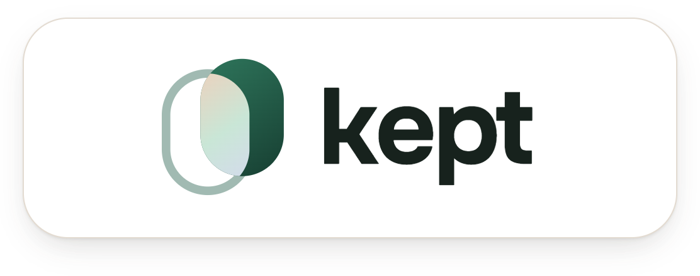

### Keep what works for your skin

Kept turns a new skincare product into a fair trial on your own face: the same photo at every check-in, YouCam Skin AI on every photo, and a verdict on whether the product deserves a place on your shelf.

**[Live app](https://kept-skin.vercel.app)** &nbsp;&nbsp; **[Demo video](#demo-video)** &nbsp;&nbsp; **[How Kept measures](https://kept-skin.vercel.app/how-it-works)** &nbsp;&nbsp; **[Pitch deck](docs/deck/kept-deck.pdf)**
<!-- DEVPOST: add the Devpost project page link to the row above once the submission is published -->


</div>

## Demo video

<!-- VIDEO PLAYER: drag kept-demo.mp4 into this README on github.com and keep the https://github.com/user-attachments/assets/… line GitHub inserts here -->
**Video:** YouTube link will be added here when the video is published.
<!-- YOUTUBE: replace the line above with [Watch the 2:30 demo on YouTube](https://www.youtube.com/watch?v=…) -->

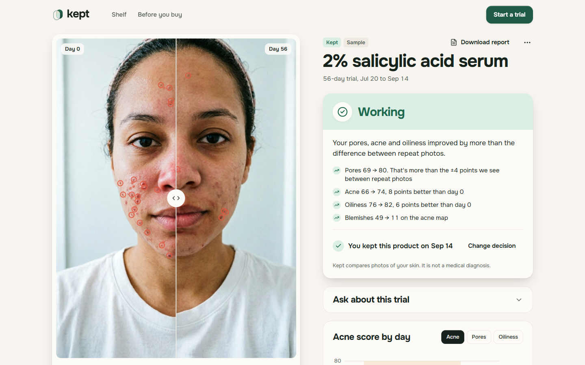

*A finished sample trial. Drag the divider to compare day 0 with day 56; the red rings are YouCam's acne map. 49 blemishes on day 0, 11 on day 56, and Kept's verdict lists the numbers behind it.*

## The moment at the mirror

You started a 2% salicylic acid serum three weeks ago. This morning your chin looks worse than before. Is the serum failing, is it a purge that will pass, or is the bathroom light just different today? Your gallery has photos from other angles and other lamps, and memory is no help.

Most people decide at that point. They drop a product that needed another month, or keep paying for one that never did anything. Active ingredients take 4 to 12 weeks, and retinoids and acids can cause a short breakout first that looks just like irritation.

Kept answers with measurements taken the same way each time:

* **Before:** a day 0 photo taken through a camera guide that checks face size, angle, light and sharpness.
* **During:** each check-in photo is lined up with a faint outline of your day 0 face, analysed by YouCam AI Skin Analysis and compared with day 0 against the timeline of the active ingredient.
* **After:** a verdict such as *Likely purging. Acne is up on day 18. Retinal often causes a short purge in weeks 2 to 6*, with a next step: keep going, use it every other night, keep it or stop it.

## Try it in two minutes

1. Open **[kept-skin.vercel.app](https://kept-skin.vercel.app)** and press **See a finished trial**. Three sample trials are copied into your browser and the salicylic serum trial opens: day 0 against day 56, verdict **Working**, decision **Kept**.
2. Open **Shelf** and pick **0.05% retinal cream**. It is on day 21 of 84 with the verdict **Likely purging**: acne 72 → 66 and blemishes 16 → 34 on day 18, inside the retinal purge window.
3. Press **Run check-in**, choose **Sample face** and send it. YouCam analyses the photo live, a new point lands on the chart and the verdict is recomputed. With the sample photo it moves to **On track**.
4. Press **Start a trial**, name the product `2% salicylic acid serum`, add **Salicylic acid** as its active, keep the suggested goals and take the baseline with **Sample face** or your own camera. After the analysis you see the skin maps, a target face simulated by YouCam Skin Simulation and the check-in schedule with **Add to calendar**.

To track your own product, start a trial with the front camera on your phone. Everything you create stays in your browser next to the samples, and **Reset sample trials** or **Remove samples** on the shelf only touch the samples.

## What Kept does

### Run a fair trial of one product

Pick the product's actives from a list of 17, or paste the INCI ingredient list and Kept finds them (it knows that `ethylhexyl salicylate` is a sunscreen filter, not salicylic acid). The actives decide the goals, the areas watched for irritation, the length of the trial and the check-in days. A salicylic serum gets acne, pores and oiliness as goals with redness watched; a retinal cream runs 84 days with a purge window from day 14 to day 42.

The camera guide runs MediaPipe Face Landmarker in the browser and only takes the photo when the checks pass: face width 55% to 80% of the frame, head turned less than 10° and tilted less than 8°, cheeks and forehead lit within a set brightness range, the face sharp, and at check-ins the face lined up with the day 0 outline. A bad photo never reaches YouCam, so it costs nothing.

| Check-in on a phone | The trial on a phone |
| --- | --- |
| 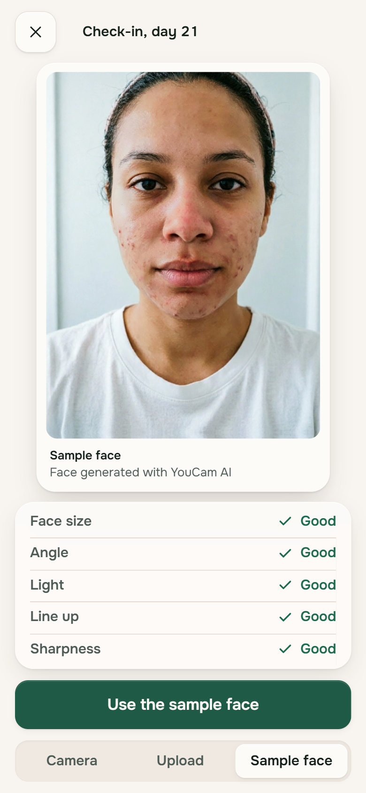 | 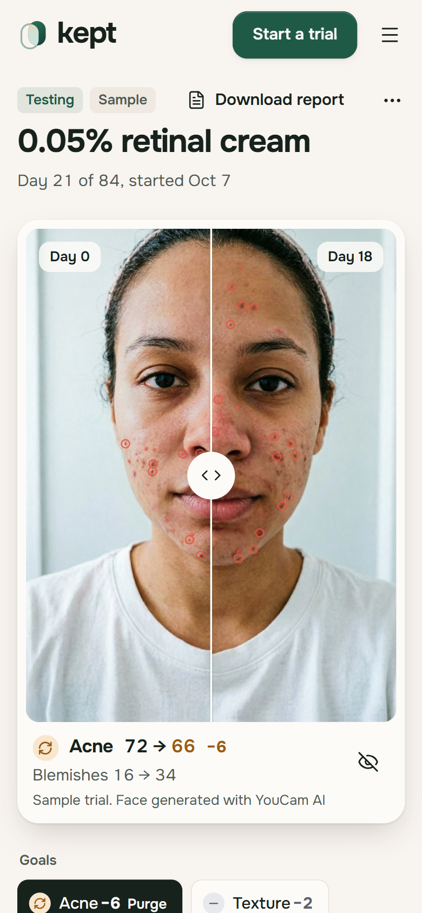 |

### Know whether it is working, purging or irritating

Every check-in becomes a verdict with two to four reasons in numbers: **Too early to tell**, **On track**, **Working**, **Likely purging**, **Your skin is reacting** or **Not doing enough**. The chart shows your score against the curve expected if the product works, with the purge window shaded.

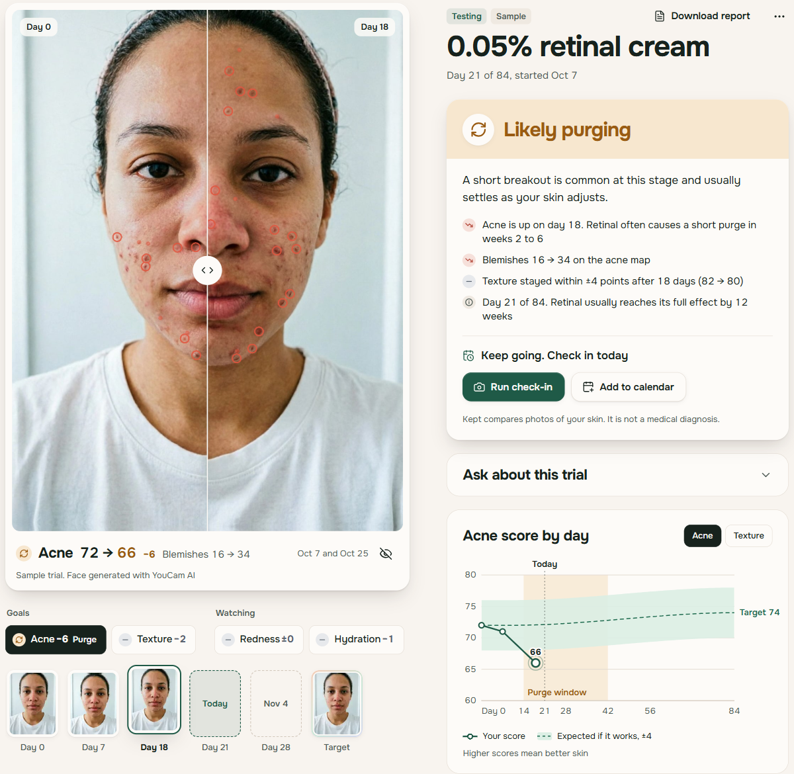

### Check a product before you buy it

Paste the ingredients of a product you are considering. Kept compares its actives with your shelf and your latest scores: you already tested this active and it did nothing, this targets an area that is already fine for you, this retinoid clashes with an acid you are testing, or it is worth a trial.

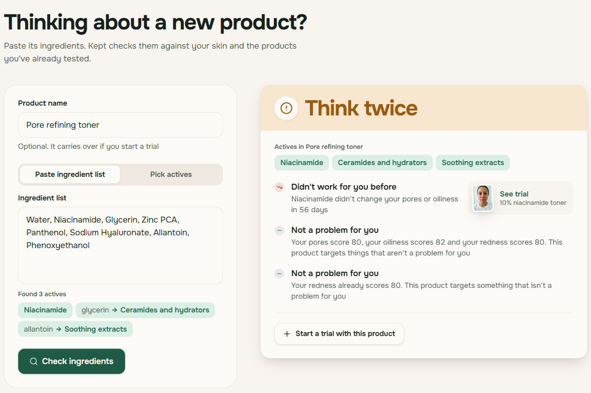

### Sunscreen without a fake promise

Sunscreen does not change skin in eight weeks, so Kept does not run a trial for it. A product whose only actives are UV filters gets a prevention screen instead: YouCam AI Aging Simulation shows the person's own face across the years, as an argument for wearing it every day.

### Take the result to a dermatologist or a store

| Trial report | Ask about this trial |
| --- | --- |
| 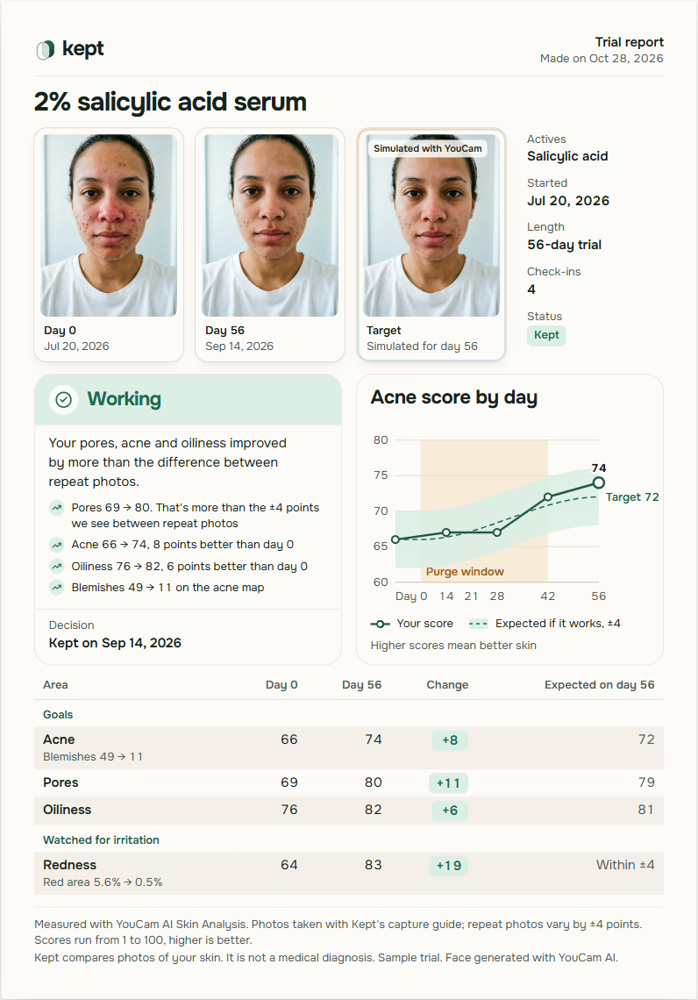 | 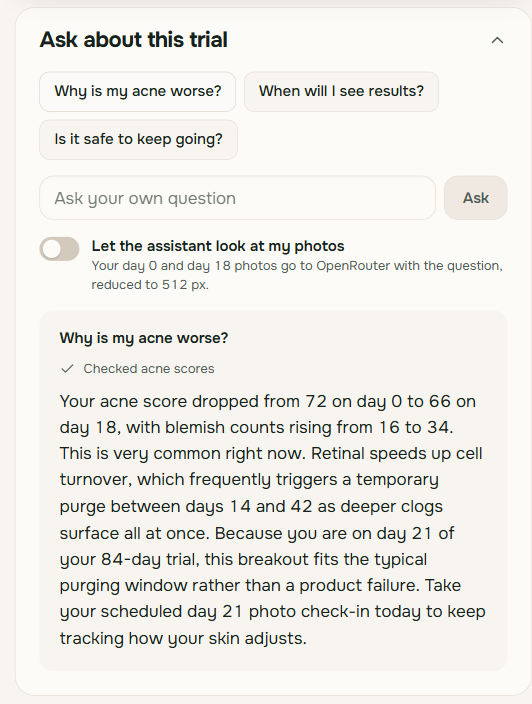 |

The report prints to PDF from the browser and has a **Copy summary** button. The assistant answers questions about the open trial with numbers it fetches through tools; the verdict itself always comes from the engine described below.

## How it works

### One check-in, from camera to decision

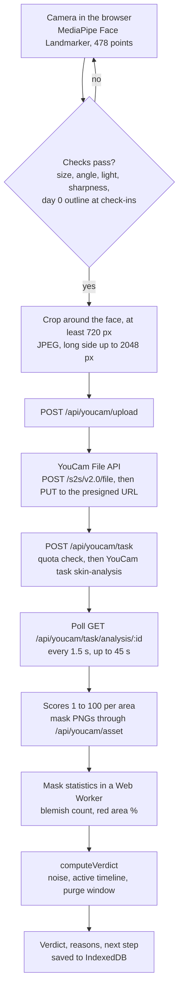

YouCam engine errors such as `error_src_face_too_small` or `error_lighting_dark` become plain advice ("Move closer so it fills the oval") and send the person back to the camera.

### The target: what the skin could look like if the product works

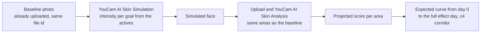

Each active carries simulation intensities (salicylic acid: acne 1, pores 0.7, oiliness 0.7). Kept simulates the baseline with them, then analyses the simulated face with the same settings as the real photos. That gives a number to aim for, not only a picture. The expected score on a given day follows an S curve that stays flat until half the onset day and reaches the projection on the full effect day:

$$\text{expected}(d) = \text{base} + (\text{target} - \text{base}) \cdot s(d), \qquad s(t) = 3t^2 - 2t^3,\quad t = \frac{d - \text{onset}/2}{\text{full} - \text{onset}/2}$$

### Modules and boundaries

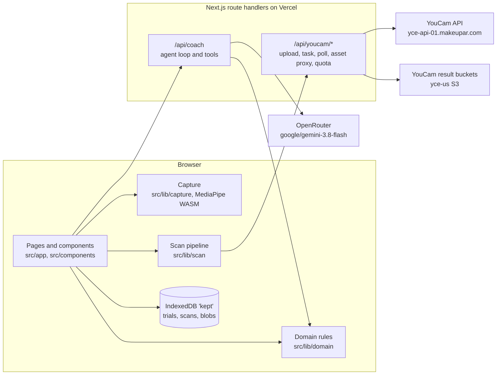

There is no database and no account. The server holds the API keys, checks spending limits and passes requests through; trials, photos, masks and scores are stored only in the browser.

## YouCam APIs used

| API | Endpoint | Where in Kept | Why |
| --- | --- | --- | --- |
| File API | `POST /s2s/v2.0/file`, then `PUT` to the returned URL | Every baseline, check-in, target and aging photo | YouCam tasks take a `file_id`, not raw bytes |
| AI Skin Analysis v2.0 (SD) | `POST /s2s/v2.0/task/skin-analysis`, `GET …/skin-analysis/{task_id}` | Baseline, each check-in, the simulated target | Scores 1 to 100 per area and a mask PNG per area. Kept requests only the trial's areas, usually 4, the cheapest tier (9 units) |
| AI Skin Simulation | `POST /s2s/v2.0/task/skin-simulation` | Trial start | The target face; its own analysis sets the expected curve |
| AI Aging Simulation | `POST /s2s/v2.0/task/aging` | Sunscreen products | The person's face across the years instead of an 8 week trial that cannot show anything |
| Credit | `GET /s2s/v1.0/client/credit` | Spending guard, cached 60 s | Stops new tasks before the balance drops under a reserve |
| AI Image Generator | `text-to-image/youcam` | `scripts/make-face.mjs` only | The sample face, so the demo uses no real person's photo |

SD analysis was chosen over HD because it works with an ordinary front camera (short side from 480 px) and a trial must use the same mode at every check-in. Result links expire after 2 hours and YouCam's S3 buckets send no CORS headers, so `/api/youcam/asset` streams masks and images to the browser, which stores them in IndexedDB right away. The proxy accepts only `https` links on YouCam's three result bucket hosts (`yce-us.s3-accelerate.amazonaws.com`, `yce-us.s3.amazonaws.com`, `yce-us.s3.us-west-2.amazonaws.com`) and only image content types.

## The verdict engine

`computeVerdict(trial, scans, now)` in [`src/lib/domain/verdict.ts`](src/lib/domain/verdict.ts) is plain TypeScript with no network calls. It compares the latest check-in with day 0 and checks the rules in this order; the first one that matches wins.

| Order | Verdict | Rule | Next step |
| --- | --- | --- | --- |
| 1 | Your skin is reacting | A watched area (redness or hydration) dropped more than 4 points outside the purge window, or more than 8 points at any time | Use it every other night and check in a week later; stop if the previous check-in also dropped |
| 2 | Likely purging | Inside the active's purge window, acne dropped more than 4 points and redness did not drop more than 8 | Keep going on the regular schedule |
| 3 | Too early to tell | Before the active's onset day | Next check-in date |
| 4 | Working | Goals improved by at least 4 points on average and at least one goal by more than 4 | Keep this product once the full effect day is reached |
| 5 | Not doing enough | Full effect day reached without that improvement | Time to stop this product |
| 6 | On track | Anything else between onset and full effect, compared with the expected curve | Next check-in date |

Reasons add the blemish count from the acne map and the change in red area from the redness map, because a score can stay flat while the map changes. Confidence drops to medium when the check-in light differs from day 0 by 10% or more, or the face is framed more than 0.1 interpupillary distances away from day 0; it drops to low above 18% light difference or when the diary says another product was started.

### How much change is real

The threshold of 4 points is measured, not chosen. [`scripts/calibrate-noise.mjs`](scripts/calibrate-noise.mjs) took one generated face, made four repeat-photo variants of it and analysed all five with SD Skin Analysis ([`scripts/calibration.json`](scripts/calibration.json)):

| Photo | Acne | Redness | Pores | Texture |
| --- | ---: | ---: | ---: | ---: |
| Original | 66 | 64 | 69 | 74 |
| Shifted 3%, scaled 0.97 | 66 | 63 | 66 | 75 |
| Brightness +6% | 66 | 64 | 68 | 74 |
| Brightness −6%, rotated 1.5° | 66 | 64 | 70 | 73 |
| Blur 0.6 px | 66 | 64 | 69 | 77 |
| **Spread, 2σ** | 0 | 0.89 | 3.03 | 3.03 |

`NOISE = ceil(max 2σ) = 4`, with a floor of 3. Oiliness (2σ 2.45) and hydration (2σ 1.10) were measured on the same photos and stay under it. A change counts when it is larger than 4 points; a strong change is larger than 8.

### Timelines of the 17 actives

From [`src/lib/domain/actives.ts`](src/lib/domain/actives.ts). Days are counted from the baseline photo. These are general guidance from dermatology practice, not medical advice, and the app says so next to every verdict.

| Active | Goals | First changes | Full effect | Purge window | Irritation |
| --- | --- | ---: | ---: | --- | --- |
| Salicylic acid | Acne, pores, oiliness | 14 | 56 | 7 to 42 | Medium |
| Benzoyl peroxide | Acne | 14 | 56 | | High |
| Adapalene | Acne, texture, pores | 21 | 84 | 14 to 49 | High |
| Retinol | Texture, fine lines, dark spots, acne | 28 | 84 | 14 to 42 | High |
| Retinal | Texture, fine lines, dark spots, acne | 21 | 84 | 14 to 42 | High |
| Gentle retinoids and bakuchiol | Texture, fine lines | 28 | 84 | | Low |
| Glycolic acid | Texture, radiance, dark spots | 14 | 42 | 7 to 28 | Medium |
| Lactic and mandelic acids | Texture, radiance | 14 | 42 | | Low |
| Azelaic acid | Redness, acne, dark spots | 28 | 84 | | Low |
| Niacinamide | Pores, oiliness, redness, dark spots | 28 | 56 | | Low |
| Vitamin C | Radiance, dark spots | 28 | 84 | | Medium |
| Tranexamic acid and arbutin | Dark spots, radiance | 42 | 84 | | Low |
| Ceramides and hydrators | Hydration, texture, redness | 7 | 28 | | Low |
| Soothing extracts | Redness | 7 | 28 | | Low |
| Peptides | Fine lines, firmness | 56 | 84 | | Low |
| Caffeine | Eye bags, dark circles | 14 | 56 | | Low |
| Sunscreen filters | Prevention, shown with Aging Simulation | | | | Low |

A product with several actives takes the earliest onset, the latest full effect and one purge window that covers all of them. Check-ins fall on days 7, 14, 21, 28, 42 and 56, cut at the full effect day, plus the full effect day itself when it comes later (day 84 for retinoids).

## What the AI assistant does and what it does not

**Ask about this trial** runs `google/gemini-3.8-flash` through OpenRouter ([`src/app/api/coach`](src/app/api/coach)). The model gets the trial summary and the verdict, and four tools that run on the server over the same domain functions the engine uses:

| Tool | Returns |
| --- | --- |
| `get_scores` | One area on every photo day, change from day 0, blemish count or red area, beyond noise or not |
| `compare_days` | All tracked areas between two days, with diary notes |
| `active_timeline` | Onset, full effect, purge window, irritation and where the trial is today |
| `expected_at` | The expected score on a day from the Skin Simulation target, against the nearest photo |

The model explains; it never decides. The system prompt forbids contradicting the verdict, quoting a number that did not come from a tool, naming a diagnosis or following instructions inside diary notes. The loop allows up to four tool rounds, streams the answer over server-sent events, caps it at about 90 words and allows 10 questions per IP a day. Photos are not sent unless the person turns on **Let the assistant look at my photos**; then the day 0 and latest photos go as 512 px JPEGs. Without `OPENROUTER_API_KEY` the panel does not appear and everything else works.

## Privacy and spending

* **Photos stay in the browser.** Trials, photos, masks, scores and diary notes live in IndexedDB on the device. The server forwards a photo to YouCam for analysis and keeps nothing.
* **The sample face is generated.** It was made with YouCam AI Image Generator and is labelled *Face generated with YouCam AI* wherever it appears.
* **The public demo cannot drain the YouCam balance.** Per server instance and UTC day: 150 units in total, 6 analyses and 70 units per IP, and no new task when the balance would fall below 60 units. Units go back to the counter when YouCam rejects a task, but not after an engine error, because YouCam charges for those. When a limit is reached the person sees *Today's free scans on this demo are used up. The sample trial shows the full flow*.

## Run it locally

Requirements: Node.js 20.9 or newer (developed on 22.13) and npm. Windows, macOS and Linux work; no Docker or database.

```bash
git clone https://github.com/DarinaX2005X/KEPT-youcam-hackathon.git
cd KEPT-youcam-hackathon
npm install
cp .env.example .env.local      # then add your keys
npm run dev
```

Open **http://localhost:3000**. The terminal prints `Ready` with the local URL once Next.js is up. Without any key you can already press **See a finished trial** and use the shelf, Before you buy and the report, since the sample trials are static files in [`public/demo`](public/demo). A live scan needs `YOUCAM_API_KEY`.

| Variable | Required | Default | Purpose |
| --- | --- | --- | --- |
| `YOUCAM_API_KEY` | For live scans | | YouCam API key from the [API console](https://yce.perfectcorp.com/api-console/en/api-keys/). Sent as `Authorization: Bearer`. Without it, upload and analysis return an error and the samples still work |
| `OPENROUTER_API_KEY` | No | | Turns on the trial assistant. Without it the panel is hidden |
| `DAILY_UNIT_CAP` | No | 150 | YouCam units per server instance per UTC day |
| `SCANS_PER_IP_PER_DAY` | No | 6 | Skin analyses per IP per day |
| `UNITS_PER_IP_PER_DAY` | No | 70 | YouCam units per IP per day, across all task kinds |
| `UNIT_RESERVE` | No | 60 | Balance below which no new task starts |
| `DEMO_UNLIMITED_IPS` | No | | Comma-separated IPs that skip the per-IP limits and the question limit |
| `COACH_MODEL` | No | `google/gemini-3.8-flash` | OpenRouter model id for the assistant |
| `COACH_QUESTIONS_PER_IP_PER_DAY` | No | 10 | Assistant questions per IP per day |
| `NEXT_PUBLIC_SITE_URL` | No | request origin | Sent to OpenRouter as `HTTP-Referer` |
| `NEXT_PUBLIC_REPO_URL` | No | | GitHub link in the footer |

The camera needs a secure context: `localhost` works, a LAN address over plain HTTP does not. To test on a phone, deploy or use an HTTPS tunnel.

### Sample data

The sample shelf in `public/demo` is committed, so nothing has to be generated. The scripts that made it call YouCam and spend units: `scripts/make-face.mjs` (sample face), `scripts/calibrate-noise.mjs` (noise) and `scripts/seed-demo.mjs` (three trials). Every score and mask in the samples is a real YouCam response; the later photos of each trial are Skin Simulations of the same face at growing strength, analysed like real check-ins.

### Deploy to Vercel

```bash
npx vercel link
npx vercel env add YOUCAM_API_KEY production
npx vercel env add OPENROUTER_API_KEY production
npx vercel --prod
```

Route handlers run on the Node.js runtime and need no extra setup. The spending counters are in memory, so each serverless instance has its own; keep `DAILY_UNIT_CAP` and `UNIT_RESERVE` conservative on a public deployment. The live app runs at [kept-skin.vercel.app](https://kept-skin.vercel.app).

## Checks

```bash
npm run check   # typecheck, unit tests, production build
```

`npm run test` runs Vitest over 16 files. They cover the six verdicts on synthetic scans, purge against reaction inside the purge window, light and confounder confidence, plans and goal picking, the INCI parser, Before you buy on the sample shelf, the sample manifest (calibrated with the engine's noise, every file present), the IndexedDB store and sample import with `fake-indexeddb`, blemish counting on real YouCam mask PNGs, the scan pipeline against a fake API, normalisation of a recorded YouCam response, quota and request validation, and the assistant's tools, stream parser and agent loop against a mocked OpenRouter stream. Tests make no calls to YouCam or OpenRouter.

## Limitations

* The noise threshold comes from variants of one photo, not from repeat photos of a real person on different days. Real bathroom light will add spread; Kept lowers confidence when light or framing differs from day 0, but cannot remove it.
* Timelines are general guidance for each active, not for a particular formula or concentration. Kept is not a medical device and does not diagnose.
* Data lives in one browser. Clearing site data deletes the trials, and there is no sync between devices.
* Spending limits are per serverless instance and reset at midnight UTC.
* The sample trials show 56 and 84 day courses built from Skin Simulation of one generated face, not from a person who used the products.

## Materials and attribution

* Skin analysis, skin simulation, aging simulation and the sample face: [YouCam API](https://docs.perfectcorp.com/develop/introduction) by Perfect Corp.
* Face landmarks: [MediaPipe Tasks Vision](https://ai.google.dev/edge/mediapipe/solutions/vision/face_landmarker), Apache 2.0; WASM from jsDelivr and the model from Google Storage, loaded only on the camera screen.
* Assistant: Gemini 3.8 Flash through [OpenRouter](https://openrouter.ai).
* Libraries: Next.js, React, `idb`, `motion`, `lucide-react`; `sharp`, Vitest, jsdom and `fake-indexeddb` for scripts and tests.
* The product concept, verdict engine, active timelines, calibration and interface were built for this project. Planning, design review and delegation followed the VibeMachina development process, a set of written instructions for AI coding agents; it contributed no code.

## License

[MIT](LICENSE)
